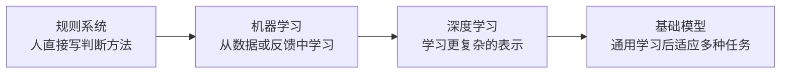

# 第 9 天：AI 发展简史

## 在全景图中的位置

本课解释今天常见 AI 方法是怎样逐步形成的，只看关键转折，不背人物和年份。

## 核心问题

AI 为什么会从人工编写规则，逐步发展到机器学习、深度学习和基础模型？

## 四个阶段

阅读时对每个阶段只回答三个问题：

1. 它主要怎样解决问题？
2. 它遇到了什么限制？
3. 下一阶段改变了什么？

## 学习重点

- 技术发展不是“新技术完全消灭旧技术”。
- 规则系统在规则明确、风险高、需要一致结果时仍然有价值。
- 深度学习是机器学习中的一类方法，不是第四种学习信号。
- 基础模型只理解其位置和作用，本周不进入底层结构。

## 自主实践

1. 制作“问题—关键转折—新增能力”关系图。
2. 为一个业务场景设想四个阶段可能采用的方案。
3. 解释旧方法为什么不会因为新方法出现而全部失效。

## 小问题

- 机器学习相对规则系统改变了什么？
- 深度学习与监督学习为什么不是同一分类维度？
- 规则系统没有覆盖新情况，能否直接称为过拟合？
- “预测下一个 Token”能否解释规则系统和所有机器学习模型？

## 完成标准

学习者不依赖日期或人物，也能用因果关系讲清四个阶段的关键转折。

---

[[01-首页/今日学习|课程入口]] · [[08-学习记录/每日记录/用途说明|记录自己的学习]] · [[00-开始学习/02-第二周/03-第10天-AI当前能力与边界|下一课]]
