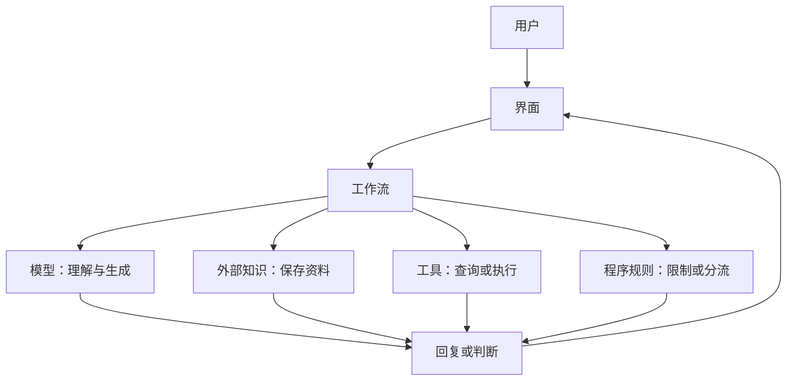

# 第 11 天：完整 AI 产品为什么不等于一个模型

## 在全景图中的位置

本课把“模型”放回完整产品中，理解用户看到的功能通常由多个部分共同完成。

## 核心问题

使用一个 AI 产品时，除了模型，还有哪些部分在共同工作？

## 简化结构

## 学习重点

- 模型负责处理输入并产生判断、预测或生成结果。
- 外部知识、数据库和搜索可以补充当前信息。
- 工具可以执行计算、查询或其他操作。
- 程序规则和界面负责限制、编排与呈现。
- 本课不展开检索增强和智能体的技术实现。

## 自主实践

1. 拆解一个常见 AI 助手或办公产品。
2. 判断哪些功能可能来自模型，哪些来自搜索、数据库、工具或普通程序。
3. 分析“换模型”和“改善整个产品”为什么不是同一件事。

## 小问题

- AI 产品给出了实时天气，是否一定代表模型参数中保存了当前天气？
- 计算器工具算出准确结果，是否等于语言模型本身完成了精确计算？
- 同一个模型放入两个不同产品，使用体验为什么可能不同？

## 完成标准

学习者不会把产品的全部信息、功能和行为都归因于模型本身。

---

[[01-首页/今日学习|课程入口]] · [[08-学习记录/每日记录/用途说明|记录自己的学习]] · [[00-开始学习/02-第二周/05-第12天-AI错误与核查|下一课]]
