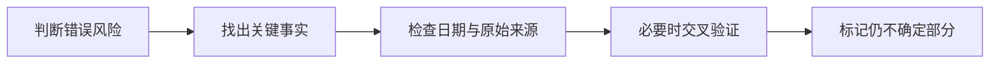

# 第 12 天：AI 为什么会出错，以及怎样核查

## 在全景图中的位置

本课从“AI 有能力”进一步走向“怎样安全使用能力”，建立与风险相匹配的核查习惯。

## 核心问题

为什么一段回答看起来流畅、合理，却仍然可能是错的？

## 常见错误来源

- 输入含糊或缺少必要信息。
- 学到的规律不等于随时准确的事实数据库。
- 信息可能过时、不完整或不适用于当前场景。
- 外部搜索、工具和数据也可能出错。
- 人可能把推测、建议和事实混为一谈。

## 基础核查流程

## 自主实践

1. 给一段 AI 回答标记事实、推断、观点和无法确认内容。
2. 核查其中两项关键事实。
3. 判断哪些问题能靠补充上下文改善，哪些需要外部资料。

## 小问题

- 语言流畅是否等于事实正确？
- 什么情况下必须优先寻找原始来源？
- 用户在对话中指出错误后，底层参数是否通常会立即改变？
- 低风险文案和高风险付款信息是否需要相同强度的核查？

## 完成标准

学习者能根据风险决定核查力度，并明确指出事实、推断、观点及仍不知道的部分。

---

[[01-首页/今日学习|课程入口]] · [[08-学习记录/每日记录/用途说明|记录自己的学习]] · [[00-开始学习/02-第二周/06-第13天-方案选择|下一课]]
