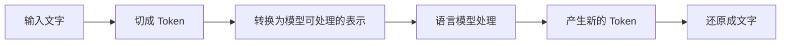

# 第 15 天：Token 在处理文字中的位置

## 在整体流程中的位置

今天只看文字进入语言模型前后的第一层转换：文字先被切成 Token，模型处理后产生新的 Token，系统再把它们还原成可读文字。

## 核心问题

Token 在语言模型处理文字时起什么作用？

## 小段 1：模型使用的是文字“小块”

人可以一眼看到一句完整的话。计算机需要先按照配套的切分规则，把文字变成一组较小的单位，再把这些单位编码成数字。这样的单位叫 Token。

因此，Token 位于“人类文字”和“模型内部计算”之间，像是文字进入模型前使用的通行格式。

### 立即检验

一句话进入语言模型时，是先作为完整句子直接被模型理解，还是先经过 Token 切分和编码？请用一句话回答。

## 小段 2：Token 不固定等于字或词

Token 可能是一个字、一个词的一部分、几个字符，也可能包含标点或空格。不同模型配套的切分规则也可能不同。

今天只记住这个边界：不能看到五个汉字，就直接断定一定是五个 Token。具体怎样切，留到第 16 天观察。

### 立即检验

“一个 Token 永远等于一个汉字”是基本正确、表达不准确，还是事实错误？说明一个理由。

## 小段 3：Token 只是完整产品中的一环

用户看到的聊天产品还可能包含界面、工作流、知识库、查询工具和安全规则。Token 处理只负责把文字准备成模型可处理的形式，并不等于整个 AI 产品。

实际系统怎样划分组件可能不同。这里使用的是帮助理解数据流的简化图，不用它推断某个具体产品的全部内部结构。

### 立即检验

一个聊天产品能搜索实时天气，是否可以只用“它会处理 Token”来解释？为什么？

## 可分段阅读任务（20—30 分钟）

1. 顺着流程图从左到右读两遍。
2. 用自己的话补全：“Token 位于文字和______之间。”
3. 找出本页两条边界：Token 不一定等于什么；Token 为什么不等于完整产品。

## 实践练习（40—60 分钟，可分段）

### 纸笔

写下“我今天开始学习大语言模型”这句话。先按汉字切一次，再按你认为可能出现的文字小块切一次。此练习只用于体会“切分单位可能不同”，不要求猜中真实分词器结果。

### 口述

用 30—60 秒解释这条链路：

> 输入文字 → Token → 模型处理 → 新 Token → 输出文字

### 新例子

换成一句含英文、数字或标点的话，指出为什么“字数或单词数”不能直接当作 Token 数。

## 完成标准

- 能指出 Token 位于文字输入与模型计算之间。
- 能说明 Token 不固定等于一个汉字或一个完整单词。
- 能区分 Token 处理与完整 AI 产品。
- 至少回答两个立即检验问题，并用一个新例子复检。

固定记录顺序：少量讲解 → 学习者回答 → 客观评价与补充 → 学习者确认 → 才能更新学习记录和课程进度。

## 复习卡与来源

- [[04-核心知识/02-大语言模型/什么是Token|Token概念卡]]：文字切分、数字表示与模型处理的位置。
- [Google LLM入门](https://developers.google.com/machine-learning/crash-course/llm)与[机器学习术语表](https://developers.google.com/machine-learning/glossary)；直接主张对应见概念卡。
- 本课流程为入门简化；概念卡核查不构成新增学习验收。

---

[[01-首页/今日学习|课程入口]] · [[08-学习记录/每日记录/用途说明|记录自己的学习]] · [[00-开始学习/03-第三周/02-第16天-观察Token/00-开始第16天|下一课]]
