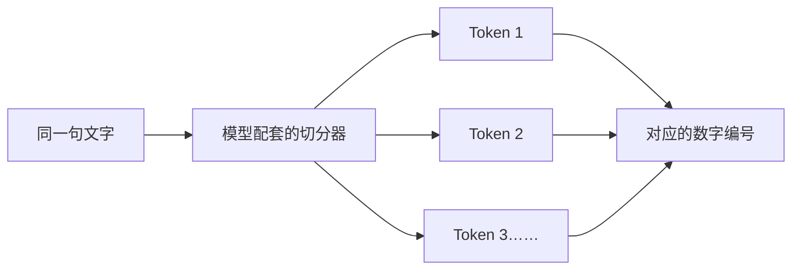

# 第 16 天：观察 Token 怎样切分

## 在整体流程中的位置

上一课确认 Token 是文字进入语言模型前使用的小单位。今天放大“切成 Token”这一步，观察不同文字可能怎样被切分。

## 核心问题

为什么字数、词数和 Token 数不能直接画等号？

## 小段 1：切分规则由配套分词器决定

语言模型通常有与自己配套的 Token 切分和编码方式。同一句话放到不同模型的配套分词器中，结果可能不同。

所以讨论 Token 数时，最好先说清楚使用的是哪套模型或分词器，不能只凭肉眼数汉字。

### 立即检验

两种模型把同一句话切成不同数量的 Token，这是否一定表示其中一个切错了？为什么？

## 小段 2：常见片段更可能整体出现

切分器通常依据训练词表把文字匹配成已有片段。常见词、词的一部分、标点、空格或特殊符号，都可能成为 Token 的一部分。

这不是按语文课的“词语”标准切分，也不是先完整理解句意再切分。

### 立即检验

Token 切分和中文分词是否一定完全相同？请说出判断。

## 小段 3：观察现象，不背规则

初学阶段不需要记住某个词一定被切成几块。更有用的是观察：换一个模型、语言、标点或生僻表达，切分结果可能改变。

我们关注的是这种变化会改变模型需要处理的 Token 数；具体成本和上下文限制放到后续课程。

### 立即检验

如果一句话加入标点，Token 数是否保证只增加一个？为什么不能直接保证？

## 可分段阅读任务（20—30 分钟）

1. 阅读三段内容，每段只记一个结论。
2. 把“汉字数、词数、Token 数”写成三个不同的标签。
3. 准备三句观察材料：一句中文、一句英文、一句中英数字混合句。

## 实践练习（40—60 分钟，可分段）

使用同一个模型配套的 Token 可视化工具，分别输入准备好的三句话。只记录：原文、切分结果、Token 数和一个意外发现。

然后只改变一个条件，例如加一个标点或替换一个生僻词，再比较变化。不要同时修改多个条件。

## 完成标准

- 能说明 Token 数取决于具体切分规则，不能只按字数或词数判断。
- 完成至少三句文字的观察，并做一次只改变一个条件的对比。
- 能用自己的话描述现象，不要求背下某个模型的固定切分结果。

固定记录顺序：少量讲解 → 学习者回答 → 客观评价与补充 → 学习者确认 → 才能更新学习记录和课程进度。

---

[[01-首页/今日学习|课程入口]] · [[08-学习记录/每日记录/用途说明|记录自己的学习]] · [[00-开始学习/03-第三周/03-第17天-训练/00-开始第17天|下一课]]
