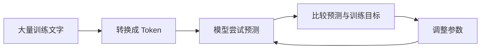

# 第 17 天：模型怎样通过训练形成能力

## 在整体流程中的位置

Token 解决文字怎样进入模型。训练解决的是：模型内部可调整的参数，怎样经过大量练习逐步形成处理语言的能力。

## 核心问题

模型为什么不是靠人工逐条写下所有回答，而是通过训练调整参数？

## 小段 1：参数是可以调整的内部数值

可以先把参数理解成模型内部大量可以调整的“旋钮”。单个旋钮通常不对应一条完整知识；许多参数共同影响模型怎样处理输入和产生输出。

训练的目的，是通过大量例子找到一组更合适的参数，而不是把每道问题的答案原样写进程序规则。

### 立即检验

把“一个参数”直接说成“一条知识”是否准确？请简单说明。

## 小段 2：训练会反复经历尝试、比较和调整

以许多语言模型的基础训练为例，模型根据前面的 Token 尝试预测后续 Token，再把预测与训练目标比较，并调整参数。这个过程会反复进行很多次。

这是帮助理解语言模型预训练的简化流程，只适用于这里讨论的语言模型，不能拿来解释所有 AI 系统。

### 立即检验

“所有 AI 都通过预测下一个 Token 来训练”属于基本正确、表达不准确，还是事实错误？

## 小段 3：训练后的模型可以成为多任务底座

经过大规模训练的模型，可能获得可用于多种任务的通用能力。这样的模型可以作为后续产品或任务的底座，因此常被称为基础模型。

“基础”表示可以继续复用和适配，不表示它能自动完成所有任务，也不表示稳定规则都应该交给它。

### 立即检验

基础模型为什么可以服务多种任务，但又不能替代所有固定规则？

## 可分段阅读任务（20—30 分钟）

1. 按顺序读流程图：数据、预测、比较、调整。
2. 分别用一句话解释“参数”和“训练”。
3. 找出本页关于“下一个 Token 预测”适用范围的限制。

## 实践练习（40—60 分钟，可分段）

### 纸笔

画一个四格循环：尝试 → 对照 → 调整 → 再尝试。每格写一句语言模型训练时发生的事。

### 口述

用“练习投篮”或“学习外语”作类比，解释为什么多次反馈可能带来改进；随后补一句类比的边界：模型调整的是参数，不是像人一样理解反馈。

### 新例子

判断图片分类器是否必须用“预测下一个 Token”解释，并给出理由。

## 完成标准

- 能说清训练的基本循环：尝试、比较、调整参数、重复。
- 能区分参数与一条具体知识。
- 能说明“预测下一个 Token”只用于相应语言模型场景，不能概括所有 AI。
- 能用一句话解释基础模型的作用和边界。

固定记录顺序：少量讲解 → 学习者回答 → 客观评价与补充 → 学习者确认 → 才能更新学习记录和课程进度。

## 复习卡与来源

- [[04-核心知识/02-大语言模型/模型参数|参数概念卡]]与[[04-核心知识/02-大语言模型/模型训练|训练概念卡]]。
- [Google机器学习术语表](https://developers.google.com/machine-learning/glossary)与[Transformer课程](https://developers.google.com/machine-learning/crash-course/llm/transformers)；参数和训练定义的主张映射见卡片。
- “尝试→比较→调整→重复”是本课使用的入门简化；不同任务的训练目标不同。

---

[[01-首页/今日学习|课程入口]] · [[08-学习记录/每日记录/用途说明|记录自己的学习]] · [[00-开始学习/03-第三周/04-第18天-推理/00-开始第18天|下一课]]
