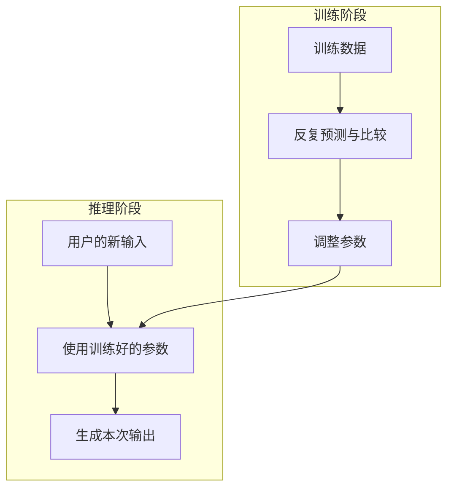

# 第 18 天：训练好的模型怎样处理新请求

## 在整体流程中的位置

训练发生在模型能力形成阶段。推理发生在使用阶段：用户给出新输入，系统使用已经训练好的参数计算输出。

## 核心问题

训练和推理都使用模型参数，它们最关键的区别是什么？

## 小段 1：推理是在使用已经形成的能力

当你向语言模型发送一个新问题，系统先把文字转换成 Token，再让模型使用已有参数进行计算，产生这一次的输出。这个使用过程叫推理。

这里的“推理”是机器学习术语，不保证模型像人一样进行严密逻辑推演。

### 立即检验

用户提出一个新问题，模型用已有参数生成回答，属于训练还是推理？

## 小段 2：使用参数不等于更新参数

训练通常会根据误差调整参数；普通对话中的推理会使用参数，但通常不会因为你纠正一句话就立刻修改底层参数。

你的纠正可能影响当前对话后续回答，因为它成为新的输入信息。这和底层参数被重新训练是两件事。

### 立即检验

“模型每次回答都不用参数，因为参数只在训练时使用”错在哪里？

## 小段 3：语言生成只是推理的一种场景

很多生成式语言模型在推理时逐步产生后续 Token。图片分类器也会进行推理，但它在任务层面输出的是类别，不应把所有 AI 推理都解释为“预测下一个 Token”。

本课只确认适用范围，不展开概率分布、采样或生成策略。

### 立即检验

猫狗图片分类模型处理一张新图片时是在推理吗？是否必须用“下一个 Token”解释？

## 可分段阅读任务（20—30 分钟）

1. 对照流程图，分别圈出训练和推理的输入。
2. 写下“使用参数”和“更新参数”的区别。
3. 找出两个都属于推理、但输出形式不同的例子。

## 实践练习（40—60 分钟，可分段）

### 纸笔对照

画两列：训练、推理。分别填写目的、输入、是否通常更新参数、生活中的发生时机。

### 口述

用 60 秒回答：“为什么我在聊天中纠正模型后，它后面可能改口，但这不等于模型已经重新训练？”

### 新例子

分别判断“用历史邮件训练垃圾邮件分类器”和“分类一封刚收到的邮件”属于训练还是推理。

## 完成标准

- 能根据新案例区分训练和推理。
- 能说明训练通常调整参数，推理使用已有参数。
- 能区分当前对话信息变化与模型底层参数更新。
- 不用“下一个 Token”解释所有 AI 的推理任务。

固定记录顺序：少量讲解 → 学习者回答 → 客观评价与补充 → 学习者确认 → 才能更新学习记录和课程进度。

## 复习卡与来源

- [[04-核心知识/02-大语言模型/模型推理|推理概念卡]]与[[04-核心知识/02-大语言模型/模型训练|训练概念卡]]。
- [Google机器学习术语表](https://developers.google.com/machine-learning/glossary)与[LLM入门](https://developers.google.com/machine-learning/crash-course/llm)；推理定义与文本生成的主张映射见卡片。
- 训练通常更新参数，推理通常使用已有参数；产品存储聊天或记忆，不等于已经证明本次更新了底层参数。

---

[[01-首页/今日学习|课程入口]] · [[08-学习记录/每日记录/用途说明|记录自己的学习]] · [[00-开始学习/03-第三周/05-第19天-Transformer/00-开始第19天|下一课]]
