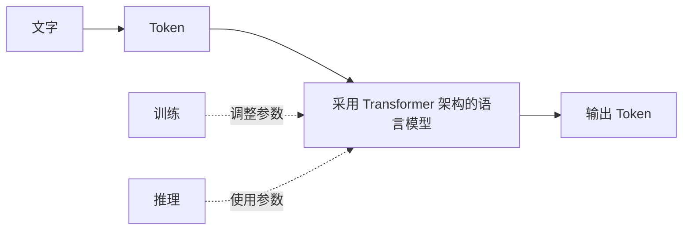

# 第 19 天：Transformer 作为模型架构的定位

## 在整体流程中的位置

Token 是输入单位，训练是形成能力的过程，推理是使用模型的过程。Transformer 则回答“这个模型内部采用什么结构来处理这些 Token”。

## 核心问题

为什么 Transformer 属于模型架构，而不是学习方式、输出能力或模态？

## 小段 1：架构像模型的结构蓝图

可以把架构理解为“模型内部各部分怎样组织和传递信息”的设计方式。Transformer 是一种模型架构，许多现代语言模型使用它处理 Token 之间的关系。

这个类比只说明组织方式。真正的 Transformer 由计算模块组成，不是房屋，也不是一张静态图纸。

### 立即检验

“Transformer”和“监督学习”能否作为同一分类维度里的两个选项？为什么？

## 小段 2：同一个系统可以同时拥有多个描述

一个系统可以采用 Transformer 架构，通过某种训练方式学习，处理文字模态，并具有生成文字的能力。这些说法可以同时成立，因为它们回答不同问题。

- Transformer：模型采用什么结构。
- 训练方式：模型怎样从数据中调整参数。
- 生成能力：模型能产生什么类型的输出。
- 文字模态：模型处理什么形式的信息。

### 立即检验

“这是一个 Transformer，所以它一定只处理文字”错在哪里？

## 小段 3：注意力机制是关键组成部分

Transformer 的关键机制之一是注意力机制，它帮助模型在处理某个位置的信息时，参考输入中其他相关位置。

今天只知道它在 Transformer 内部的位置；第 20 天再用句子例子观察这种关联。

### 立即检验

注意力机制是在完整 AI 产品的界面层，还是在模型内部的计算结构中？

## 可分段阅读任务（20—30 分钟）

1. 给四个标签分别写问题：架构、学习方式、输出能力、模态。
2. 把 Transformer 放到正确标签下。
3. 顺着流程图说出训练和推理怎样与同一模型发生关系。

## 实践练习（40—60 分钟，可分段）

### 分类卡片

把“Transformer、监督学习、生成文字、文字模态”分别写在四张纸上，再为每张补一句“它回答的问题”。

### 口述

用“建筑结构蓝图”作类比，在一分钟内解释 Transformer；结尾补充类比不能解释真实计算细节。

### 新例子

判断下面描述是否混淆维度：“这个模型采用 Transformer，所以它的学习方式叫生成式 AI。”

## 完成标准

- 能把 Transformer 放在“模型架构”这一维度。
- 能区分架构、学习方式、输出能力和模态。
- 能指出注意力机制位于 Transformer 内部，但暂不要求解释细节。
- 能用新例子识别一次维度混淆。

固定记录顺序：少量讲解 → 学习者回答 → 客观评价与补充 → 学习者确认 → 才能更新学习记录和课程进度。

## 复习卡与来源

- [[04-核心知识/02-大语言模型/Transformer是什么|Transformer概念卡]]与[[03-知识地图/大模型知识地图|大模型知识地图]]。
- [Google Transformer课程](https://developers.google.com/machine-learning/crash-course/llm/transformers)，支持架构与注意力机制的关系；主张映射见卡片。
- 架构类比帮助定位，不能当作完整内部计算说明。注意力细节仍留待第20天。

---

[[01-首页/今日学习|课程入口]] · [[08-学习记录/每日记录/用途说明|记录自己的学习]] · [[00-开始学习/03-第三周/06-第20天-注意力机制/00-开始第20天|下一课]]
