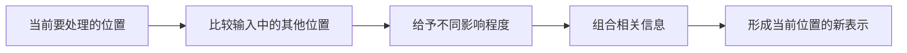

# 第 20 天：注意力机制怎样关联信息

## 在整体流程中的位置

注意力机制位于 Transformer 内部。模型处理某个位置时，会让不同位置的信息产生不同影响，再把相关信息组合起来。

## 核心问题

为什么模型处理一句话中的某个位置时，需要同时参考其他位置？

## 小段 1：一句话里的信息会互相影响

看句子“猫钻进纸箱，因为纸箱里面很温暖”。处理“温暖”时，“纸箱”和“里面”比句首的其他词更直接相关。

注意力机制让模型在处理一个位置时，可以参考输入中的其他位置，而不是只看紧挨着的一个词。

### 立即检验

在上面的句子中，理解“里面”最需要联系哪个前面出现的对象？

## 小段 2：不同位置的影响程度不同

注意力不是简单地“看”或“不看”。在一次计算中，不同位置会对当前处理产生不同程度的影响。这样，模型可以根据正在处理的内容组合信息。

“关注”是便于理解的类比，不代表模型像人一样有意识或主动集中精神。

### 立即检验

说模型“有注意力”是否等于说它像人一样拥有意识？为什么？

## 小段 3：能建立关联不等于保证理解正确

注意力机制提供了关联信息的计算方式，但句子本身可能含糊，训练中也可能没有形成可靠规律。因此，模型仍可能关联错对象或给出错误回答。

本课只确认机制作用，不提前展开幻觉和评测。

### 立即检验

一句话有两个可能指代对象时，注意力机制是否保证模型一定选对？

## 可分段阅读任务（20—30 分钟）

1. 读流程图并用四个动词复述：处理、比较、分配、组合。
2. 在一句工作消息中圈出两个需要相互联系的词或短语。
3. 写下“注意力不等于人的注意力”的原因。

## 实践练习（40—60 分钟，可分段）

### 纸笔连线

选两句较长的话，用箭头连接代词、对象、动作和条件之间的关系。每次只解释一条连线为什么重要。

### 口述

不用公式，用一分钟解释：“如果模型只能看当前词，处理长句会遇到什么问题？注意力机制怎样帮助它？”

### 边界练习

自己写一句有歧义的话，说明为什么即使可以关联多个位置，也不保证得到唯一正确解释。

## 完成标准

- 能指出注意力机制位于 Transformer 内部。
- 能说明它帮助当前位置参考其他相关位置，并让不同位置产生不同影响。
- 不把注意力类比成人的意识。
- 知道建立关联不等于保证答案正确。

固定记录顺序：少量讲解 → 学习者回答 → 客观评价与补充 → 学习者确认 → 才能更新学习记录和课程进度。

---

[[01-首页/今日学习|课程入口]] · [[08-学习记录/每日记录/用途说明|记录自己的学习]] · [[00-开始学习/03-第三周/07-第21天-串联与复检/00-开始第21天|下一课]]
