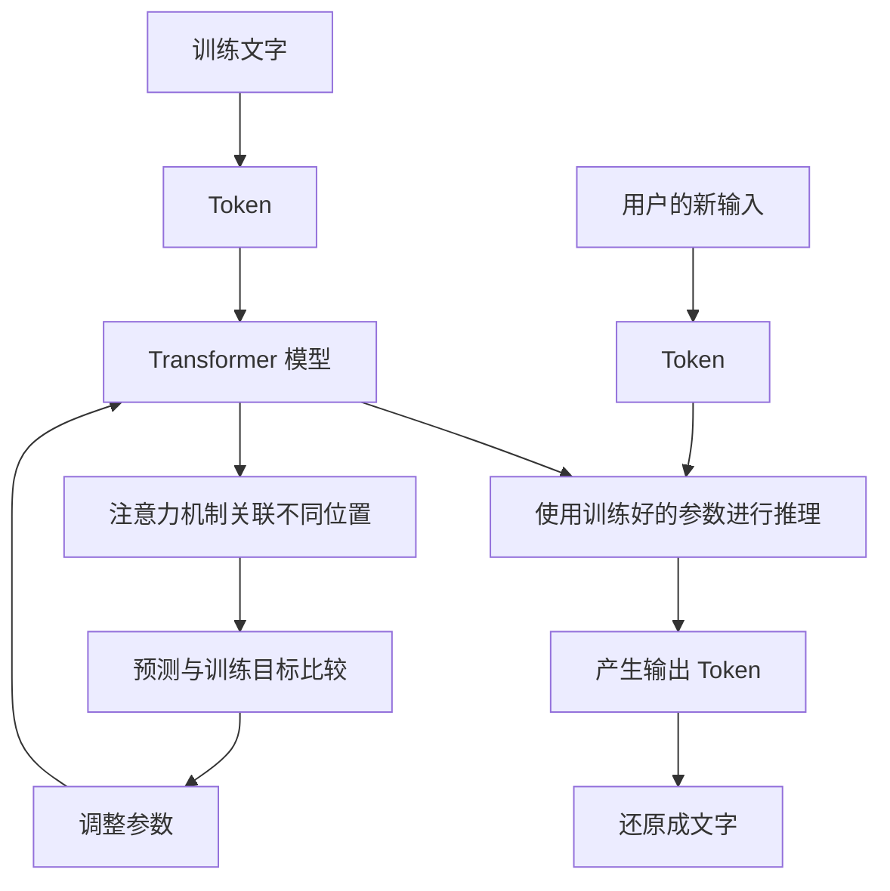

# 第 21 天：串联 Token、训练、推理与注意力

## 在整体流程中的位置

今天把本周的五个概念放回同一张图：Token 是文字单位，Transformer 是模型架构，注意力机制在架构内部关联信息，训练调整参数，推理使用参数处理新输入。

## 核心问题

能否从一段输入文字开始，把五个概念的位置、作用和关系连续讲清楚？

## 小段 1：先分清“单位、结构、机制、过程”

- Token：模型处理文字时使用的单位。
- Transformer：一种模型架构。
- 注意力机制：Transformer 中关联不同位置的信息的关键机制。
- 训练：通过练习和反馈调整参数的过程。
- 推理：使用训练好的参数处理新输入的过程。

### 立即检验

把五个概念分别放入“文字单位、模型结构、内部机制、形成能力、使用能力”五个位置。

## 小段 2：训练和推理经过同一个模型，但目标不同

训练阶段反复调整参数，让模型逐步形成能力；推理阶段使用这些参数，处理用户当前提供的新输入。两者都可能处理 Token，但是否更新参数是关键区别之一。

普通对话中的一次纠正可能改变后续上下文信息，通常不等于立即重新训练底层参数。

### 立即检验

用户纠正回答后，模型在同一对话中改口，能否直接证明底层参数已经更新？

## 小段 3：完整产品仍然不等于模型

真实产品还可能用到界面、知识库、规则、工具和工作流。今天的流程图主要描述语言模型部分，不能用它解释实时数据从哪里来、操作是否真正执行等产品问题。

### 立即检验

模型生成“订单已提交”这句话，是否足以证明订单系统真的收到订单？还需要检查什么？

## 可分段阅读任务（20—30 分钟）

1. 遮住概念解释，只看图说出五个概念的位置。
2. 找出训练与推理的两条路径。
3. 选出一个仍需要提示的概念，准备一个新例子。

## 实践练习（40—60 分钟，可分段）

### 自画流程图

不看本页，画出“文字 → Token → 模型 → 输出”的主线，再补上训练、推理、Transformer 和注意力机制。

### 三分钟口述

假设听众从未学过 AI，用三分钟解释本周主线。允许先看五个关键词提纲，第二次尝试时减少提示。

### 新案例复检

选择一个语言模型产品，分别说出模型内部流程和产品外部组件。再判断一条产品说法属于“已经有可靠反证的错误”，还是“目前未经充分核实”。

## 完成标准

- 能在图中正确放置 Token、Transformer、注意力机制、训练和推理。
- 能用新例子区分训练与推理、使用参数与更新参数。
- 能说明本周流程主要解释语言模型，不能代表所有 AI 或完整产品。
- 完成一次三分钟口述；评价分别记录事实准确性、表达准确性和连贯性。

固定记录顺序：少量讲解 → 学习者回答 → 客观评价与补充 → 学习者确认 → 才能更新学习记录和课程进度。

---

[[01-首页/今日学习|课程入口]] · [[08-学习记录/每日记录/用途说明|记录自己的学习]] · [[00-开始学习/04-第四周/01-第22天-上下文窗口/00-开始第22天|下一课]]
