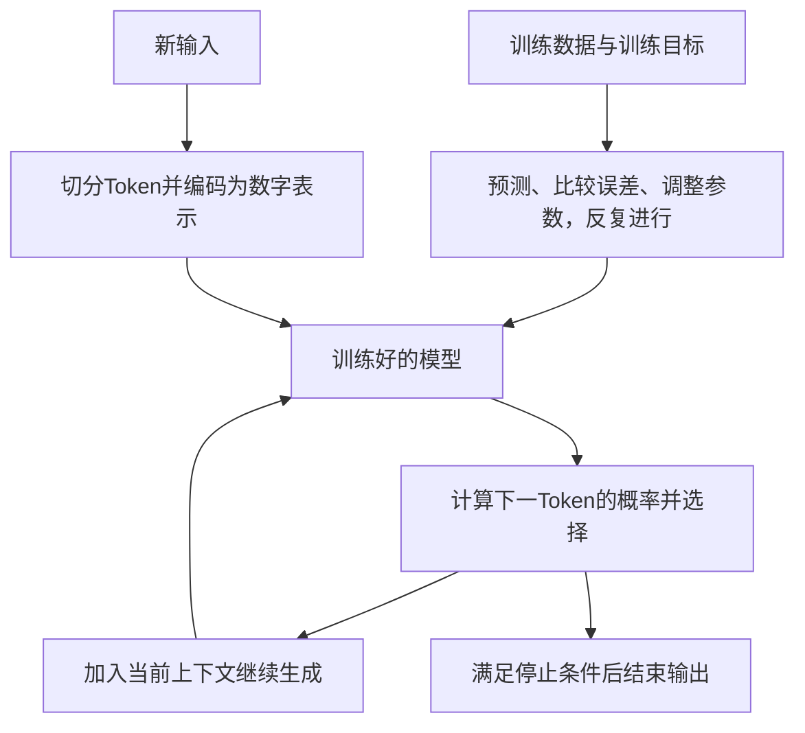

# 大模型知识地图

- 参数：参与计算的数值，训练时调整。
- 推理：使用已有模型处理新输入，普通聊天反馈不会立即训练底层参数。
- Transformer：深度神经网络的一类架构，说明内部各部分怎样组织和传递信息。
- 注意力机制：Transformer中的计算办法之一。
- 上下文窗口：本次可处理的信息范围；文件存在不代表已读入。

[[04-核心知识/02-大语言模型/Transformer是什么|Transformer教材]] · [[08-学习记录/AI基础总笔记-持续更新|各课核心笔记]]
