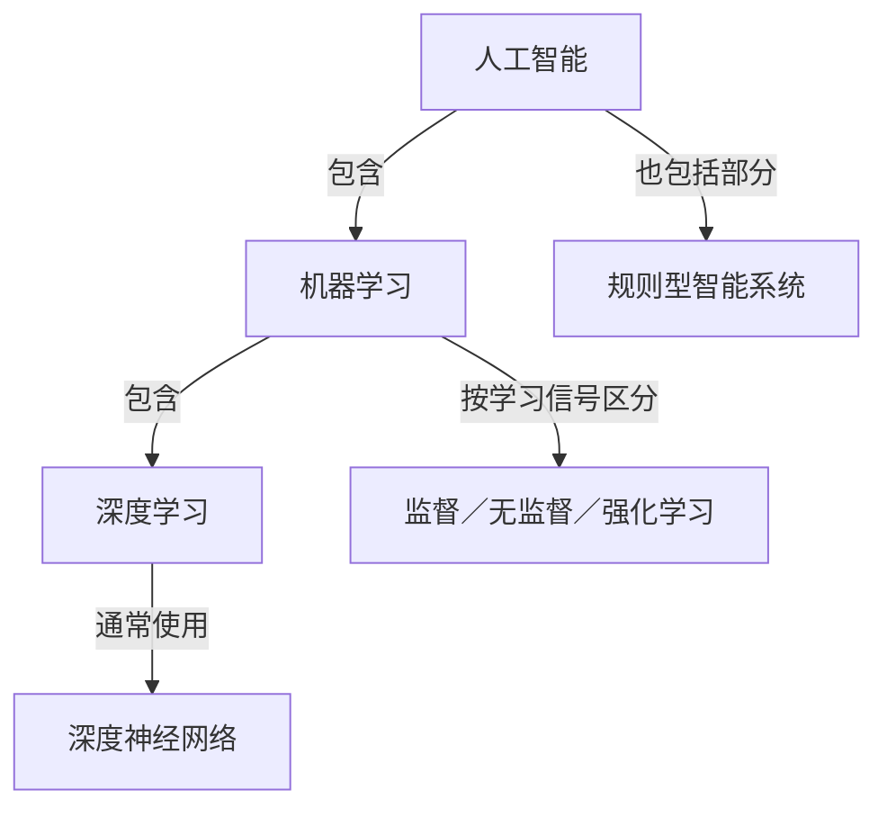

# 第一周知识关系图

这不是所有AI方法的完整分类。普通定时开灯不因有规则就必然属于AI。

|描述维度|回答的问题|
|---|---|
|学习方式|从什么信号中学习？|
|模型结构／架构|内部怎样组织计算？|
|输出能力|判断、预测还是生成内容？|
|模态|输入输出是文本、图像、语音还是视频等？|

深度学习是机器学习的一类方法，深度神经网络是它常用的模型结构。常见生成式大语言模型既处理语言，也能生成内容；生成式AI不只有语言模型。

[[03-知识地图/AI全景图|查看产品层面的关系]]
